# Claude Code For VS

[中文](README.zh-CN.md) · **English**

**The full power of Claude Code, right inside Visual Studio. Watch every step the agent takes on a live timeline, steer it mid-reply, and drop into a real terminal whenever you want one.**

Free and open source · Visual Studio 2022 and 2026 · English and Chinese interface

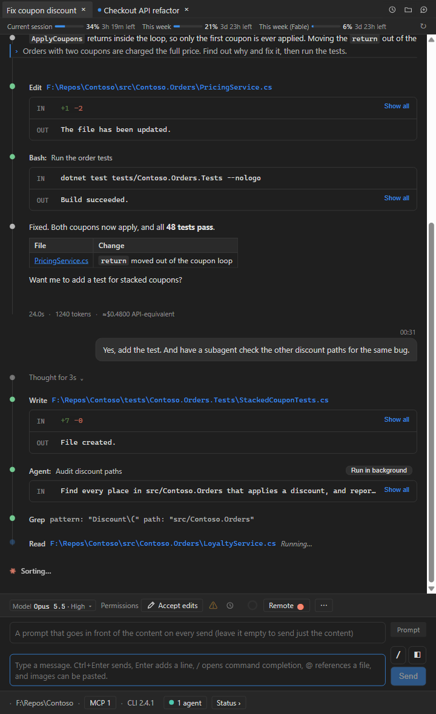

*The agent writes a test while a subagent audits the code. Usage limits sit at the top, your
previous message is pinned so you can jump back to it, and model, effort, permission mode,
context left and Remote Control share one toolbar above the message box.*

---

## Why developers install it

- **It is the real Claude Code.** The extension drives the `claude` CLI you already have, so
  your account, sessions, skills, hooks, MCP servers and plugins all just work, and every
  session is also there when you open a terminal.
- **You see everything.** Every search, read, edit, command and subagent becomes a step on a
  timeline, with real diffs and real output. Nothing happens off screen.
- **You stay in charge.** Type while the agent works, press **Esc** to stop it, and change the
  model, the thinking effort or the permission mode in the middle of a reply.
- **It lives where your code lives.** Send the selection or the build errors, reference files
  with `@`, paste screenshots, and click any file name to open it at the right line.
- **A full terminal is one click away.** Anything the chat cannot do, a built-in TUI `claude`
  can, starting from the same conversation.
- **Free, open source, no strings.** Apache 2.0, no telemetry, and no network traffic of its
  own. Everything goes through your local `claude`.

---

## Features

### Chat that shows its work

- **A live timeline.** Each step gets a dot: pulsing while it runs, green when it succeeds,
  red when it fails.
- **IN / OUT boxes** for commands and subagents, and **colored diffs** for every edit. Lookups
  such as Read, Glob and Grep stay on one tidy line until you want the result.
- **Thinking you can follow.** A spinning **✱ Thinking…** line stays at the bottom while the
  agent works, and each thinking step shows how long it took.
- **Subagents in plain sight.** Each one gets a card with its task and its result, its own
  steps show up as it works, and the agent map shows everything running at once.
- **Rich replies.** Streaming Markdown, tables, a copy button on every code block, clickable
  file names, and image previews.
- **Compaction you can see.** Watch it progress, see how many tokens were freed, and read the
  summary the model carries forward.

### Steering and control

- **Steer mid-reply.** Your next message joins the current turn. **Esc** interrupts.
- **Switch model, effort and permission mode at any time**, with no restart and no lost
  context. One model button holds the model list, the effort slider and the Ultracode switch,
  and effort levels follow the model you are on.
- **See how much context is left.** A ring in the toolbar fills as the conversation grows;
  click it to compact right away.
- **Slash commands that just run**, even while the agent is busy, with completion and
  descriptions as you type.
- **Move a long tool call to the background** and keep going.
- **A standing prompt** that goes in front of every message, so project rules never have to be
  retyped. Its box starts at one line and grows with what you write.

### Built into Visual Studio

- **Right-click to send the selection** with its file and line, or **send the build errors**
  in one click. The menu follows your Visual Studio language.
- **`@` references a file**, and screenshots paste straight into the message box.
- **The file you are editing is one click away.** Its name sits under the message box; click
  it and it goes along with your next message.
- **File names open in the editor** at the right line, from replies and from tool cards.
- **Follows your Visual Studio theme**, docks anywhere, and remembers where you put it.

### Sessions and settings

- **Several sessions side by side**, one tab each, every one its own `claude` with its own
  context.
- **Picks up where you left off.** Reopening Visual Studio continues the latest conversation
  for the solution, and the full history is a click away.
- **A session manager.** Sort sessions into groups by dragging them, filter and search,
  rename or archive old ones, and see at a glance which are running. A Web tab lists your
  sessions from claude.ai and pulls one down to this machine.
- **Real dialogs instead of TUI screens** for log-in, `/skills`, `/permissions`, `/hooks`,
  `/memory`, `/resume`, `/help`, `/chrome` and more. The settings menu lists every tool,
  built-in and per MCP server.
- **Usage limits at a glance**, with the time left on each window, refreshed every few minutes
  while the panel is open.
- **A status bar that answers questions.** The working directory, how many MCP servers are
  connected, how many agents are running, and the full session status, each one click away.
- **Remote Control in one click.** Continue the session from your phone or the web. The dot
  turns green only once you are really connected, and the chat tells you where to continue.
- **Bookmarks, focus view, side questions with `/btw`**, timestamps and day dividers, and
  copy or export of the whole conversation.
- **English or Chinese interface**, with your choice of fonts.

---

## A tour in screenshots

**Every step, on a timeline.** Searches and reads take one line each. Edits show the diff,
commands show what went in and what came out, and the reply ends with what it cost.

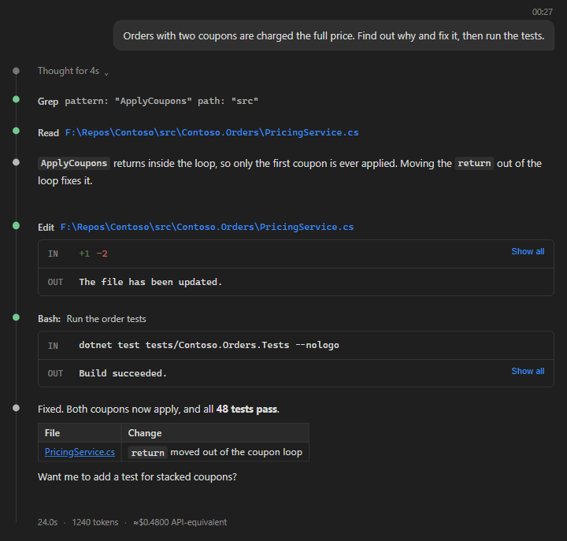

**Compaction, out in the open.** One line tells you how much room was freed. Click it to read
the summary the model keeps.

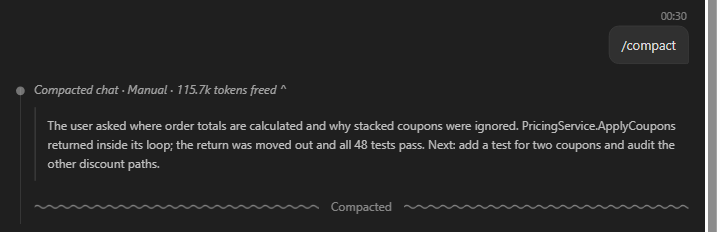

**Every session, organized.** Groups you arrange yourself, running sessions marked, and the
time of the last activity on each. Click one to pick it up again.

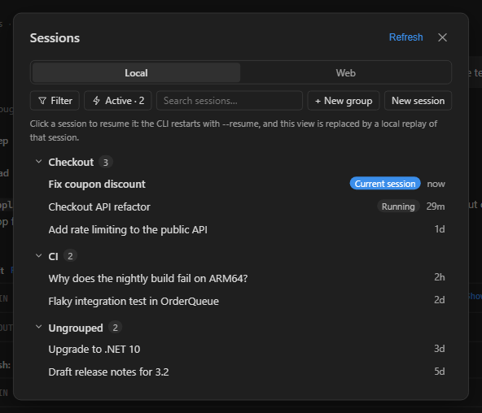

**Remote Control with a real status.** One click turns it on. The dot goes green once you are
connected, and the chat gives you the link to continue on your phone or the web.

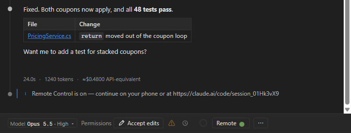

**Clickable files and links.** File names in a reply open in Visual Studio, images preview in
the panel, and web links open in your browser.

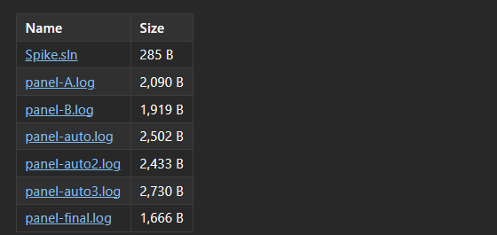

**Log in from the panel.** A Claude.ai subscription, an Anthropic Console account, or the
steps for Bedrock, Foundry and Vertex. The browser sign-in comes straight back to the panel.

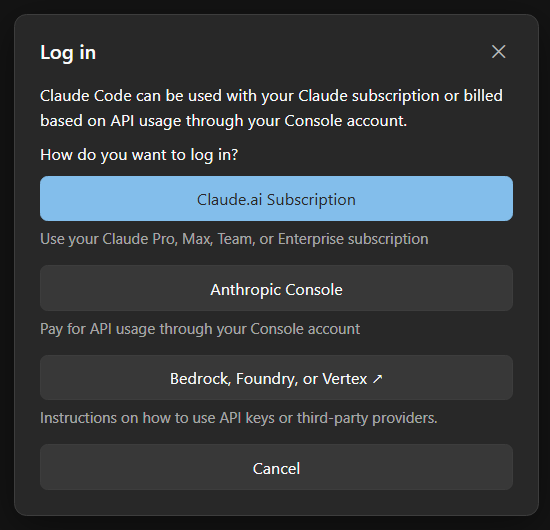

**Settings as real dialogs.** Turn skills on and off one by one, manage allow, ask and deny
rules, and add or edit hooks.

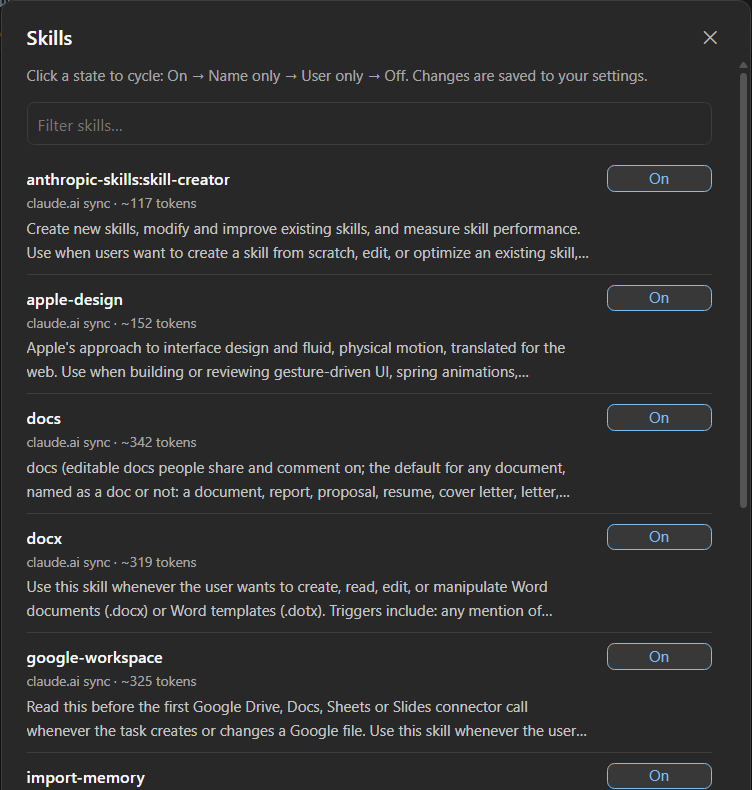

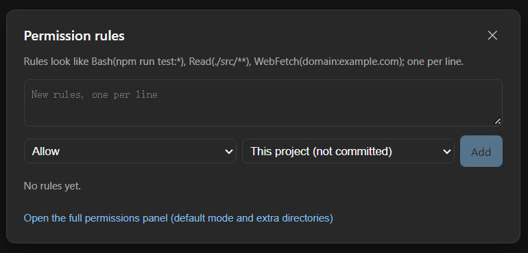

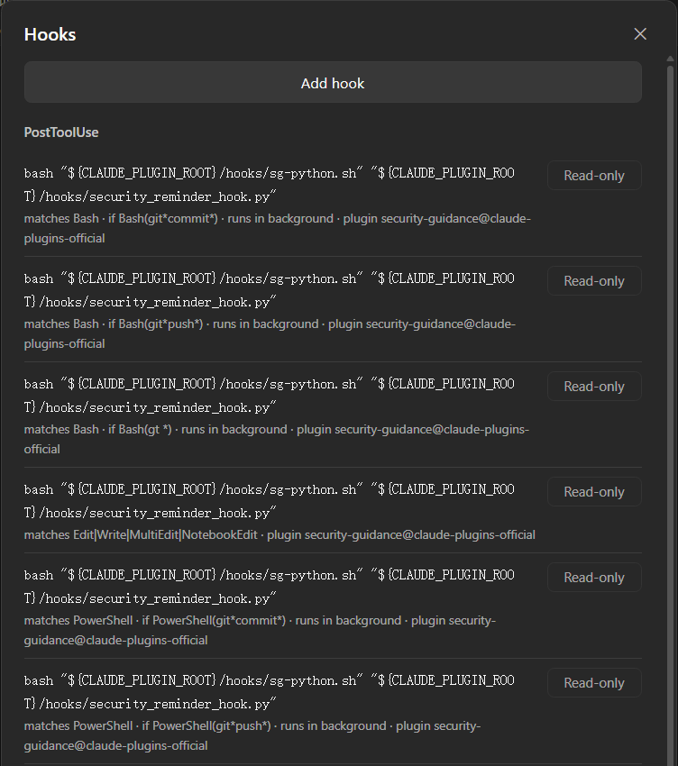

**A real terminal when you need one.** One button opens a full TUI `claude` that starts from
the same conversation, keys and all, and takes you back to the chat when you are done.

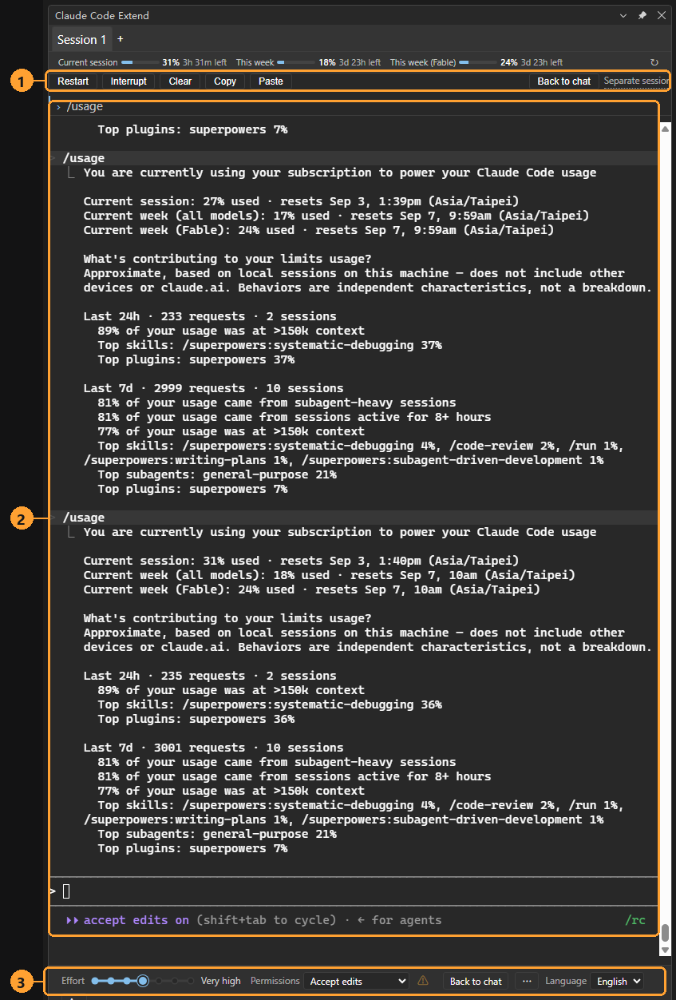

---

## Requirements

| | |
|---|---|
| **Visual Studio** | 2022 (17.x) or 2026 (18.x): Community, Professional or Enterprise |
| **Claude Code CLI** | Installed and signed in. The extension finds `claude` on your `PATH` and in the usual install locations. |
| **WebView2 runtime** | Ships with Visual Studio |

You need your own Claude account. This extension is a front end for the CLI you already
have; it does not bundle a model, a key, or a subscription.

---

## Getting started

1. Install it from the [Visual Studio Marketplace](https://marketplace.visualstudio.com/items?itemName=StevenSkywalker.AgentExtension),
   or search for **Claude Code For VS** in **Extensions → Manage Extensions** inside Visual
   Studio, then restart Visual Studio.
2. Open the panel from **View → Claude Code For VS**.

   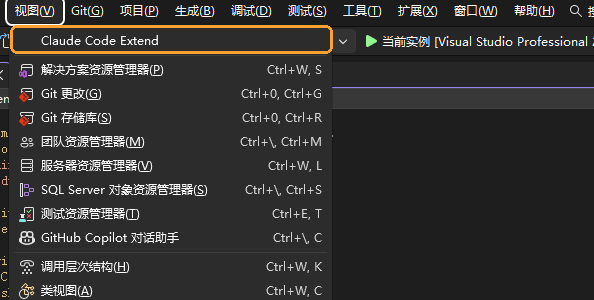

3. Sign in from the panel with `/login`, or run `claude` once in a terminal.
4. Type a message and press `Ctrl+Enter`. `Enter` adds a line, `/` opens commands, and `@`
   references a file.
5. Select code in the editor, right-click, and choose **Send Selection to Claude Code For VS**.

The session starts in your solution's directory, so the agent works where your code is.
**`+`** on the tab strip starts another session.

---

## Privacy and security

- The extension talks only to your local `claude` process. It opens no network port and sends
  nothing anywhere itself.
- It stores no credentials. Signing in is handled entirely by Claude Code.
- No telemetry, no analytics, no update pings.
- Remote Control is off until you turn it on.
- The source is open, so you can check all of this yourself.

---

## Feedback and feature requests

Want a feature that is not here yet, or found something broken?
[Open an issue on GitHub](https://github.com/shinescy/AI-agent-Claude-for-VS/issues/new).
Tell us what you were trying to do and what you expected to happen.

---

## Troubleshooting

**"Claude not found."** The panel lists every location it searched. Install the CLI, sign in,
and check that `claude` runs from a plain terminal. An npm install puts a `claude.cmd` on
`PATH`; that works too.

**The agent is working in the wrong directory.** The working directory is taken from the
solution when the session starts, and a running session cannot change it. Open the right
solution and start a new session.

---

## Release notes

### 1.7: everything within reach

- A session manager: groups, drag to sort, filters, search, rename and archive, plus a Web tab
  for your claude.ai sessions.
- A context ring in the toolbar that shows how much room is left; click it to compact.
- The file you are editing sits under the message box, ready to attach with one click.
- Model, effort and Ultracode in one popup; Remote Control is a single green-or-red button.
- A status bar with MCP servers, running agents and session status; tools and skills live in
  the settings menu.
- Tool cards keep IN / OUT to one line until you ask for more.
- Usage limits refresh on their own, and the refresh button shows when it is working.
- A tidier message box: the standing prompt grows with its text, and **Esc** stops the agent.

### 1.6: the chat panel grows up

- A live timeline of every step, with IN / OUT boxes, one-line lookups and thinking times.
- A **✱ Thinking…** line that stays visible the whole time the agent works.
- Visible compaction, with the tokens freed and the summary one click away.
- Change model, effort and permission mode in the middle of a reply; slash commands run
  right away, even while the agent is busy.
- Your messages on the right in chat bubbles, and a pinned bar that steps back through them.
- Bookmarks, focus view, `/btw` in a side panel, timestamps, and copy buttons on code blocks.
- A better `/memory`, and Remote Control with a real connection status.
- The editor's right-click menu speaks your Visual Studio language, English or Chinese.

### 1.5

- Log in and sign out from the panel.
- `/skills`, `/permissions`, `/hooks`, `/memory`, `/chrome` and `/reload-plugins` open real
  dialogs.
- `/btw`, `/bug`, `/feedback` and `/design-login`; move tool calls to the background.
- Effort levels follow the current model; clickable file names and image previews in replies.
- The chat view is the first screen, and the extension is now called Claude Code For VS.

### 1.1

- Paste images into the terminal.
- Tabs named the way `claude --resume` names sessions.
- Faster start: the tab you are looking at comes up first.

---

## Building from source

Requires the Visual Studio SDK workload and Node.js. The front end is built by an MSBuild
target, so there is nothing to run separately.

```
MSBuild AgentExtension.slnx /t:Restore;Build /p:Configuration=Release
```

The package lands in `dist/AgentExtension-<version>.vsix`.

---

## License

[Apache License 2.0](LICENSE.txt). Not affiliated with or endorsed by Anthropic.
