# Claude Code For VS

**中文** · [English](README.md)

**把完整的 Claude Code 搬进 Visual Studio。代理的每一步都实时排在时间线上，回复到一半也能插话改方向，想要真终端，点一下就有。**

免费开源 · 支持 Visual Studio 2022 与 2026 · 中英文界面

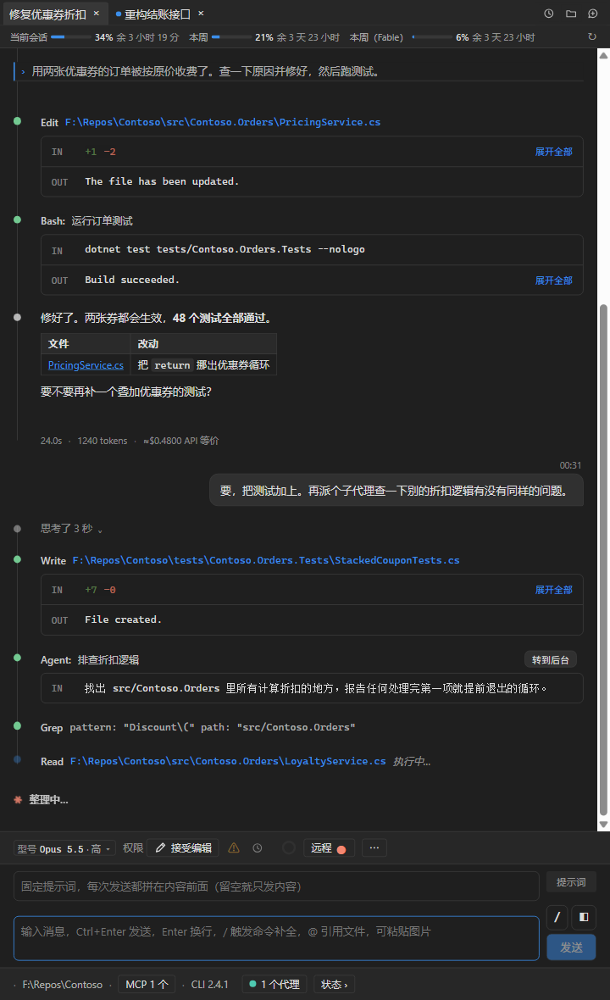

*代理一边写测试，一边派子代理排查代码。顶部是额度用量；上一条提问吸在顶上，点一下就跳回去；
模型、思考强度、权限模式、剩余上下文和远程控制都在输入框上方的同一条工具栏里。*

---

## 为什么装它

- **就是正版 Claude Code。** 扩展驱动的是你本机已经装好的 `claude`，账号、会话、技能、钩子、
  MCP 服务器、插件全部照常可用；在这里聊的会话，打开终端也能看到。
- **一切都看得见。** 每次搜索、读文件、改代码、跑命令、派子代理，都是时间线上的一步，
  有真实的 diff 和真实的输出，没有藏在幕后的操作。
- **方向盘在你手里。** 代理干活时照样能打字，**Esc** 随时叫停，回复到一半也能换模型、
  换思考强度、换权限模式。
- **就在代码旁边。** 选中代码或编译错误一键发送，`@` 引用文件，截图直接粘贴，
  回复里的文件名一点就跳到对应行。
- **真终端只差一下点击。** 聊天面板做不到的事，内置的完整 TUI `claude` 都能做，
  而且接着同一段对话往下聊。
- **免费、开源、不设套路。** Apache 2.0 许可，不收集数据，扩展本身不联网，
  一切都经过你本机的 `claude`。

---

## 功能一览

### 把过程摆出来的聊天

- **实时时间线。** 每一步一个圆点：进行中闪烁，成功变绿，失败变红。
- **IN / OUT 两格**展示命令和子代理的输入输出，每次改动都是**彩色 diff**。Read、Glob、Grep
  这类查找只占一行，想看结果再点开。
- **思考过程跟得上。** 代理干活期间，底部始终转着一行 **✱ 思考中…**，每段思考都标出用了几秒。
- **子代理一目了然。** 每个子代理一张卡片，写着任务和结果，它的每一步也实时出现；
  代理地图把正在跑的全部列出来。
- **排版完整的回复。** 流式 Markdown、表格、每个代码块都带复制按钮，文件名可点，图片直接预览。
- **压缩看得见。** 压缩时有进度，完成后告诉你腾出了多少 token，摘要点开就能读。

### 随时掌控

- **回复中途插话。** 你发的下一句会并进当前这一轮，**Esc** 打断。
- **随时换模型、思考强度、权限模式**，不重启、不丢上下文。一个型号按钮里装着模型列表、
  强度滑轨和 Ultracode 开关，强度档位跟着当前模型走。
- **上下文还剩多少一眼可见。** 工具栏上的圆环随对话变长而填满，点一下立即压缩。
- **斜杠命令选中就执行**，代理忙着也照样跑，边打边补全、带说明。
- **耗时的工具调用可以转到后台**，你接着干别的。
- **固定前缀提示词**，每次发送都加在前面，项目规矩不用反复打。输入框从一行起，写多少长多高。

### 长在 Visual Studio 里

- **右键发送选中代码**（带文件名和行号），或一键**发送构建错误**。菜单文字跟随 Visual Studio 的界面语言。
- **`@` 引用文件**，截图直接粘进输入框。
- **正在编辑的文件一点就带上。** 它的文件名就在输入框下方，点一下，下一条消息就附上它。
- **文件名点了就在编辑器里打开**，回复里、工具卡片上都一样，有行号就跳到那一行。
- **跟随 Visual Studio 主题**，停靠在哪都行，下次还开在原处。

### 会话与设置

- **多个会话并排**，一个 tab 一个，各自是独立的 `claude`、独立的上下文。
- **接着上次聊。** 重开 Visual Studio 自动接回这个解决方案最近的对话，更早的在历史里点一下就回来。
- **会话管理。** 拖动会话分组，筛选、搜索，给旧会话改名或存档，哪些正在跑一眼就知道。
  Web 页签列出你在 claude.ai 上的会话，可以拉回本机接着做。
- **真正的对话框代替 TUI 界面**：登录、`/skills`、`/permissions`、`/hooks`、`/memory`、
  `/resume`、`/help`、`/chrome` 等等。设置菜单里列出全部工具，内置的和各 MCP 服务器的分开列。
- **额度用量一眼可见**，每个窗口还剩多久都写着，面板开着时每隔几分钟自动刷新。
- **有问必答的状态栏。** 工作目录、已连上几个 MCP 服务器、正在跑几个代理、完整的会话状态，都是点一下就看。
- **远程控制一键开关。** 在手机或网页上接着这条会话聊。只有真连上了圆点才变绿，聊天里会告诉你去哪儿接着聊。
- **书签、专注视图、`/btw` 旁支提问**、时间戳与日期分隔，整段对话可复制或导出。
- **中文或英文界面**，字体随你挑。

---

## 截图导览

**每一步都在时间线上。** 搜索和读文件各占一行；改动给出 diff，命令给出输入和输出，
一轮结束还告诉你花了多少。

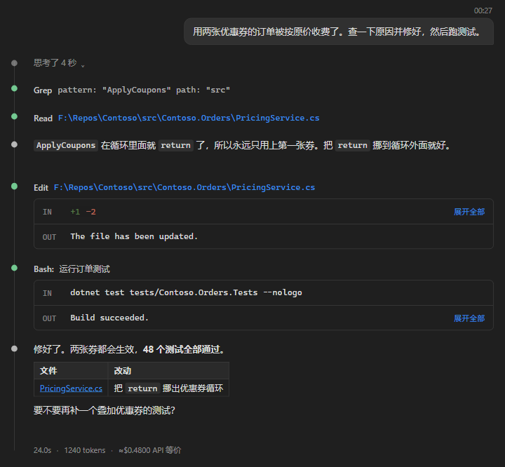

**压缩摆在明面上。** 一行字告诉你腾出了多少空间，点开就是模型保留下来的摘要。

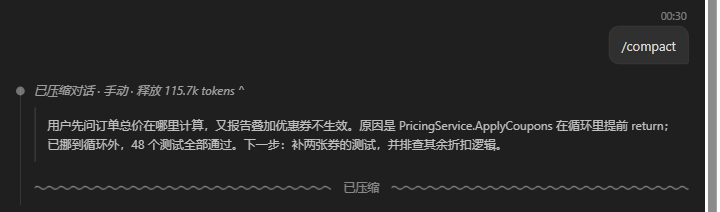

**会话井井有条。** 分组由你自己排，正在跑的会话有标记，每条都写着最后活动时间，点一下就接回来。

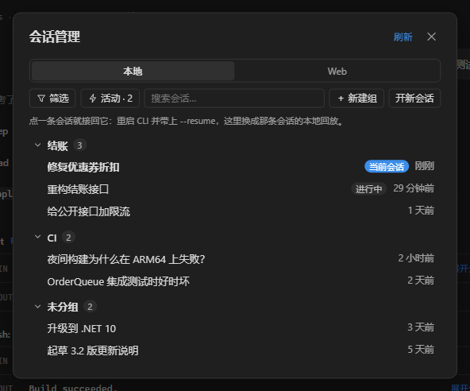

**远程控制有真实状态。** 点一下就开，连上了圆点变绿，聊天里给出在手机或网页上继续的链接。

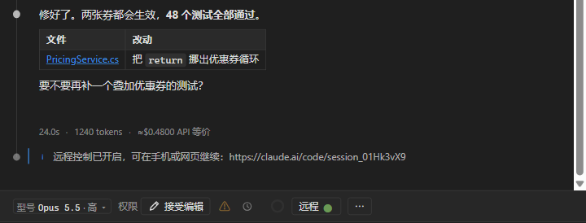

**文件和链接都能点。** 回复里的文件名在 Visual Studio 里打开，图片在面板里预览，网页链接用浏览器打开。

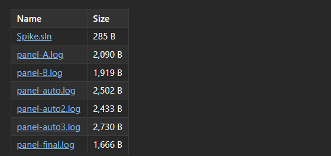

**在面板里登录。** Claude.ai 订阅、Anthropic Console 账号，或者 Bedrock、Foundry、Vertex
的配置说明。浏览器登录完会自己回到面板。

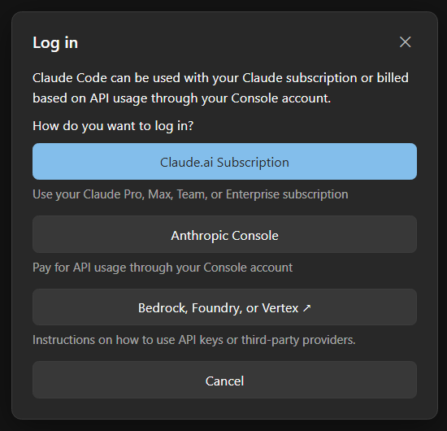

**设置是真正的对话框。** 逐个开关技能，管理允许、询问、拒绝规则，增改钩子。

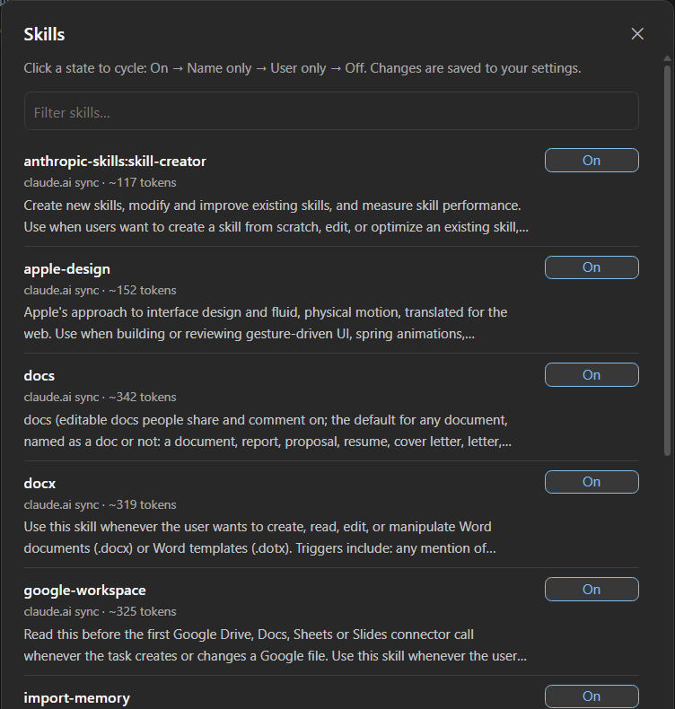

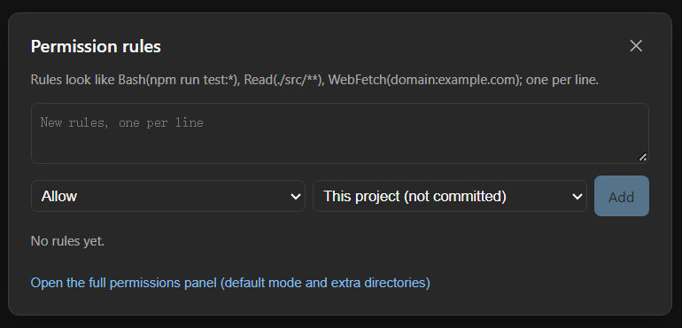

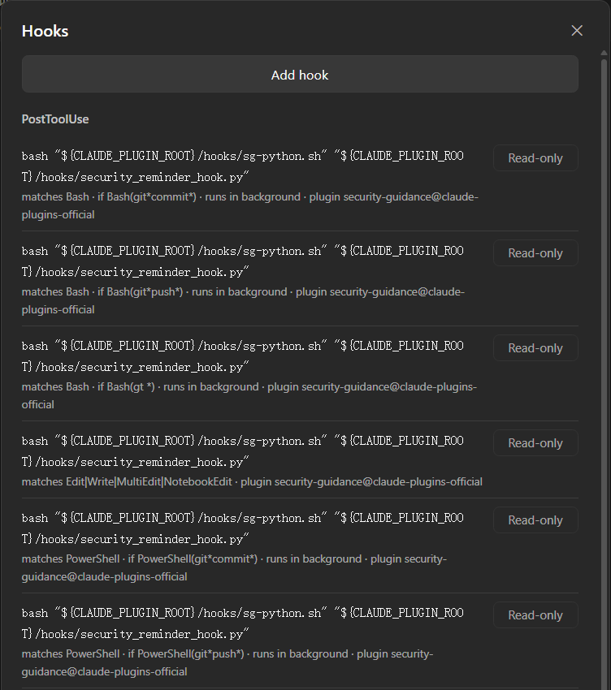

**需要时有真终端。** 一个按钮打开完整 TUI 的 `claude`，接着同一段对话开始，按键全都照旧，
用完一键回到聊天。

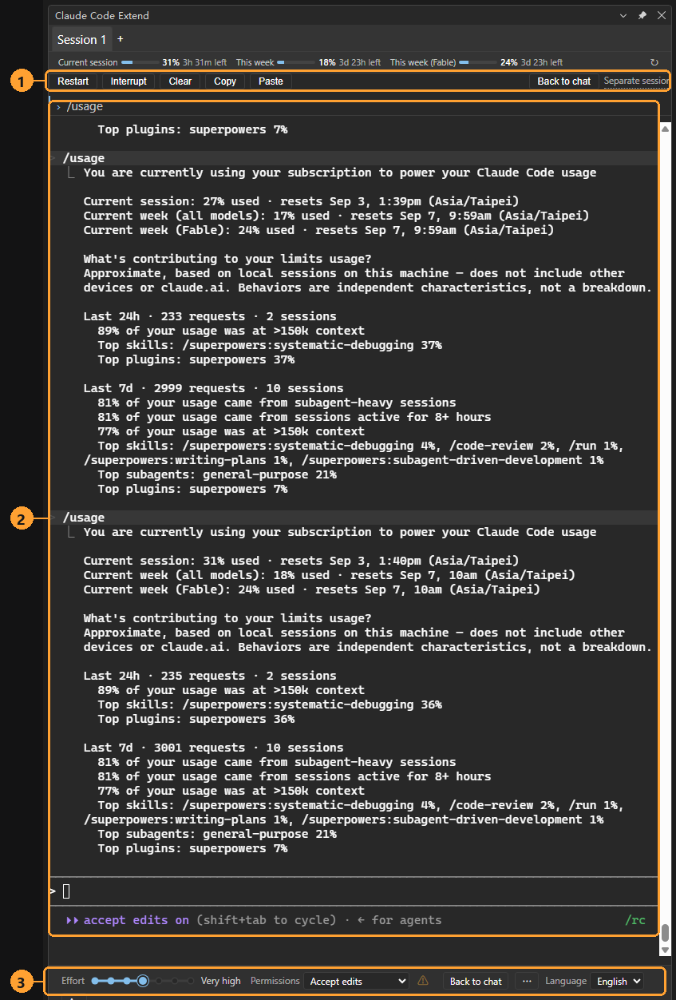

---

## 环境要求

| | |
|---|---|
| **Visual Studio** | 2022 (17.x) 或 2026 (18.x)：Community、Professional、Enterprise 都行 |
| **Claude Code CLI** | 已安装并登录。扩展会在 `PATH` 和几个常见安装位置找 `claude`。 |
| **WebView2 运行时** | Visual Studio 自带 |

你得有自己的 Claude 账号。这个扩展是你已有的那个 CLI 的前端，不自带模型、不自带密钥、不自带订阅。

---

## 上手

1. 从 [Visual Studio 市场](https://marketplace.visualstudio.com/items?itemName=StevenSkywalker.AgentExtension)安装，
   或在 Visual Studio 的 **扩展 → 管理扩展** 里搜索 **Claude Code For VS**，然后重启 Visual Studio。
2. 从 **视图 → Claude Code For VS** 打开面板。

   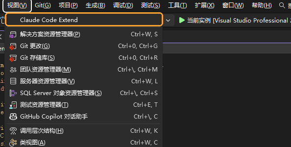

3. 在面板里用 `/login` 登录，或者在终端里先跑一次 `claude`。
4. 输入消息，按 `Ctrl+Enter` 发送。`Enter` 换行，`/` 打开命令，`@` 引用文件。
5. 在编辑器里选中代码，右键 **发送选中代码到 Claude Code For VS**，就把它带进了对话。

会话在解决方案所在目录启动，代理干活的地方就是你代码所在的地方。tab 条上的 **`+`** 再开一条会话。

---

## 隐私与安全

- 扩展只和你本机的 `claude` 进程通信，不开任何网络端口，自己不往外发任何东西。
- 不保存任何凭据，登录完全由 Claude Code 自己处理。
- 没有遥测、没有统计、没有检查更新的请求。
- 远程控制在你打开之前一直是关着的。
- 源码公开，以上每一条你都可以自己核对。

---

## 反馈与功能建议

想要还没有的功能，或者遇到了问题？[到 GitHub 提一个 issue](https://github.com/shinescy/AI-agent-Claude-for-VS/issues/new)。
说说你想做什么、期望它怎样表现就好。

---

## 排查

**提示「找不到 claude」。** 面板会把找过的位置全列出来。装好 CLI、登录，确认在普通终端里敲
`claude` 能跑起来。npm 装出来的是 `claude.cmd`，同样认。

**代理在错的目录里干活。** 工作目录是会话启动那一刻从解决方案取的，跑起来之后改不了。
打开正确的解决方案，再开一条新会话。

---

## 更新说明

### 1.7：伸手就够得着

- 会话管理：分组、拖动归组、筛选、搜索、改名、存档，另有 Web 页签管 claude.ai 上的会话。
- 工具栏上的上下文圆环，显示还剩多少空间，点一下就压缩。
- 正在编辑的文件显示在输入框下方，点一下就附上。
- 模型、思考强度、Ultracode 收进同一个弹窗；远程控制只剩一个红绿圆点按钮。
- 底部状态栏显示 MCP 服务器、正在跑的代理和会话状态；工具和技能放进设置菜单。
- 工具卡片的 IN / OUT 默认只占一行，想看全部再展开。
- 额度用量自动刷新，手动刷新时有转圈提示。
- 更清爽的输入框：固定提示词随内容长高，**Esc** 叫停代理。

### 1.6：聊天面板真正长大了

- 每一步都在实时时间线上：IN / OUT 两格、查找类只占一行、思考标出用时。
- 代理干活期间，底部始终显示 **✱ 思考中…**。
- 压缩看得见：腾出多少 token 一目了然，摘要点开就读。
- 回复中途能换模型、思考强度、权限模式；斜杠命令选中就执行，代理忙着也一样。
- 你的消息在右侧以气泡显示，顶部吸顶栏可以一条条往回翻。
- 书签、专注视图、`/btw` 侧边面板、时间戳、代码块复制按钮。
- 更好用的 `/memory`；远程控制有真实的连接状态。
- 编辑器右键菜单跟随 Visual Studio 的界面语言，中英文都有。

### 1.5

- 在面板里登录、退出。
- `/skills`、`/permissions`、`/hooks`、`/memory`、`/chrome`、`/reload-plugins` 都是真正的对话框。
- `/btw`、`/bug`、`/feedback`、`/design-login`；工具调用可以转到后台。
- 思考强度档位跟着当前模型走；回复里的文件名可点、图片可预览。
- 打开就是聊天视图；扩展改名为 Claude Code For VS。

### 1.1

- 终端里可以粘贴图片。
- tab 名和 `claude --resume` 里显示的会话名一致。
- 启动更快：眼前这个 tab 最先起来。

---

## 从源码构建

需要 Visual Studio SDK 工作负载和 Node.js。前端由 MSBuild 目标顺带构建，不用另外跑。

```
MSBuild AgentExtension.slnx /t:Restore;Build /p:Configuration=Release
```

产物在 `dist/AgentExtension-<版本号>.vsix`。

---

## 许可证

[Apache License 2.0](LICENSE.txt)。与 Anthropic 无从属关系，也未获其背书。
